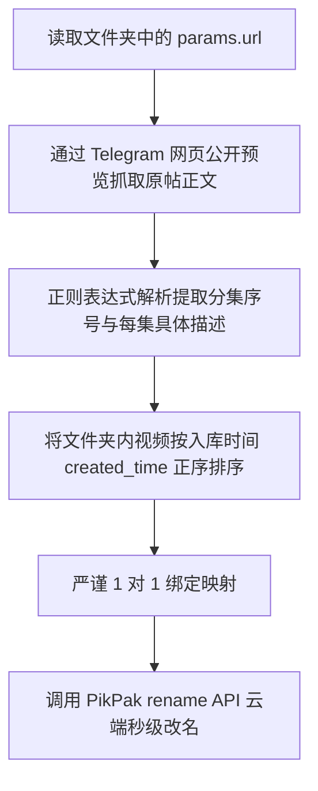

# 03. Telegram 资源转存乱象溯源与全自动运维闭环

> 核心思路：解决 Telegram 频道图文混发转发至 PikPak 时造成的命名丢失与随机临时名问题；并通过轻量 Telegram Bot 打造从手机发令到电脑全自动执行的运维闭环。

---

## 1. 乱象成因：为什么 Telegram 机器人转存后视频名全乱了？

在 Telegram 中，博主通常采用以下形式发布多媒体合集：
1. 一条长文案（包含系列主题、各集期号、详细剧情说明）；
2. 随后紧跟一个包含多段视频的媒体组（Media Group / Album）或连续单发多条视频。

当用户使用 PikPak 官方的 Telegram 转存机器人时：
- 机器人会把当前转发的消息首行长文案当成了文件夹名称；
- 由于 Telegram 限制或网盘文件名长度限制，长文案往往被中间硬性截断；
- 文件夹内部的视频文件则完全丢失了原始文案，全部被赋予类似 `tmp_xxxxxx.mp4` 的系统随机临时名称；
- 用户在网盘中完全无法分辨第几集是哪个视频。

---

## 2. 元数据破局：时间戳严格对齐算法

我们通过深度分析 PikPak 内部文件对象的底层属性发现了转机：
1. **原帖链接完整保留**：
   在文件夹及各个文件的 `params.url` 属性中，完整记录了类似 `https://t.me/ChannelName/PostID` 的原始消息链接。
2. **入库时间严格递增**：
   各个视频文件入库时记录了精确到毫秒的时间戳（`created_time`）。PikPak 机器人在顺序处理 TG 媒体组时，是严格按照 TG 消息发布顺序逐一入库的。

### 自动化对齐与更名逻辑

全流程纯云端元数据修改，不需要下载任何视频，数十个视频仅需 1 秒即可全部恢复规范命名。

---

## 3. 终极闭环：Telegram 远程运维中枢（本地电脑Gemini）

为了让用户彻底摆脱“每次都必须打开电脑终端运行脚本”的繁琐操作，我们在项目中引入了 Telegram Bot 网桥架构：

```text
【用户手机 Telegram】
       │
       │ 发送指令 /ls 或直接发送 PikPak 链接
       ▼
【本地 Windows 后台运行的 Telegram Bot 守护进程】
       │
       │ 调用本项目 core 与 tools 工具
       ▼
【全自动执行：M3U8 转码 / 智能重命名 / 终端遥控】
       │
       │ 实时反馈结果
       ▼
【手机端实时收到完成通知】
```

### 关键安全机制：用户白名单锁
机器人通过硬编码绑定的 `telegram_allowed_user_id`（你的唯一 Telegram 数字 ID）进行严格鉴权：
```python
if message.from_user.id != ALLOWED_USER_ID:
    bot.reply_to(message, "⛔ 未授权访问")
    return
```
任何非白名单用户发送任何指令都会被直接拦截，彻底杜绝陌生人探测和恶意调用本地电脑的风险。
